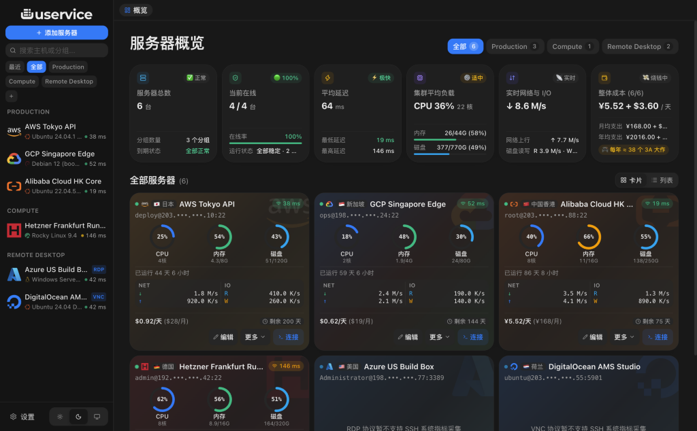
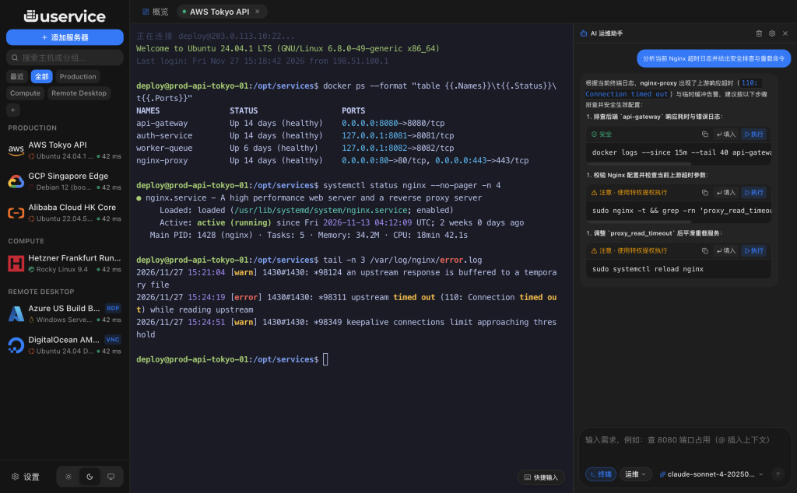
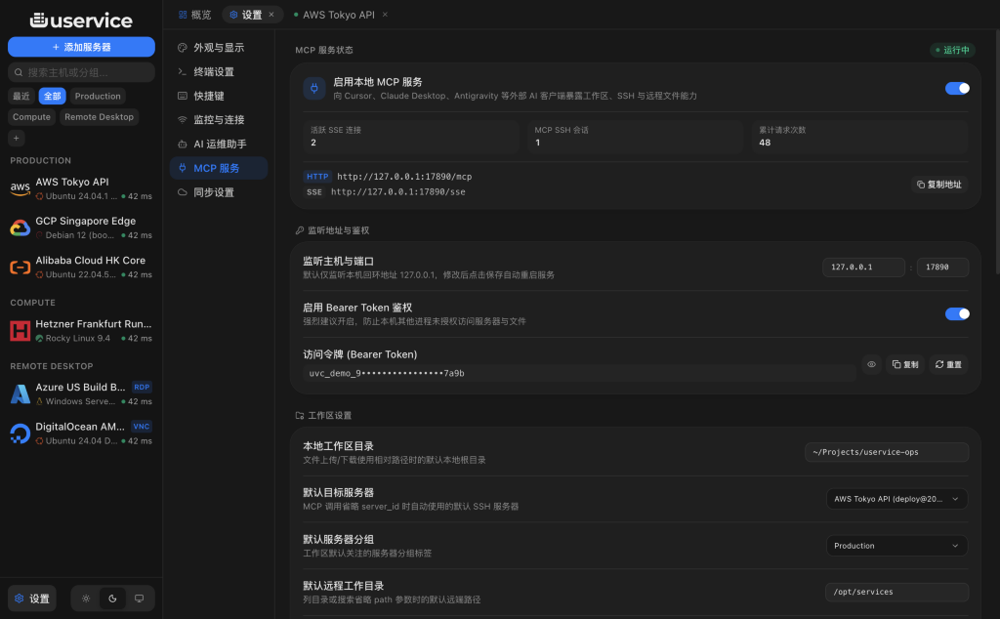
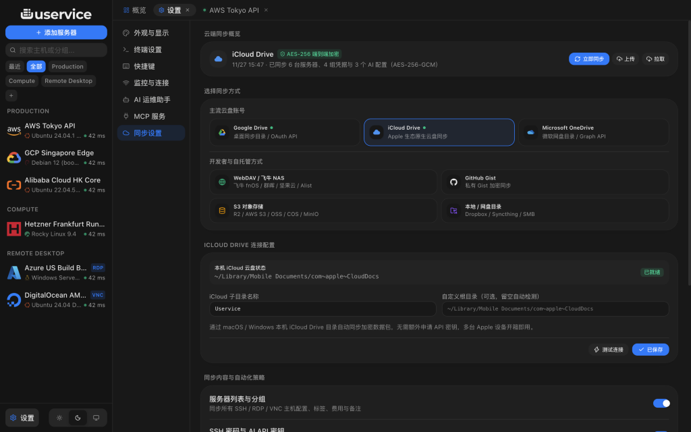

<div align="center">
  <picture>
    <source media="(prefers-color-scheme: dark)" srcset="assets/logo/uservice-logo-dark.svg">
    <source media="(prefers-color-scheme: light)" srcset="assets/logo/uservice-logo-light.svg">
    
  </picture>

  <p><strong>Cross-platform server management client built with Tauri 2 &amp; Rust</strong></p>

  <p>
    <a href="README.md">简体中文</a> ·
    <a href="README.en.md">English</a>
  </p>

  <p>
    <a href="https://github.com/anxu1860/Uservice/actions/workflows/ci.yml"></a>
    <a href="LICENSE"></a>
    
    
    
  </p>
</div>

---

**Uservice** is an open-source, cross-platform server management client built with Tauri 2, Rust, and React for macOS, Windows, and Linux. It unifies SSH, VNC, and RDP connections in a clean native workspace, combines a built-in AI terminal assistant with a local MCP server for AI-driven operations, and protects your credentials with a local encrypted vault and end-to-end encrypted multi-device sync.

## Screenshots

### Server Overview
Manage multi-cloud hosts, groups, provider/region badges, and cost/expiration tracking in one view.



### SSH Terminal & Built-in AI Assistant
Powered by pure-Rust `russh` and WebGL-accelerated `xterm.js` with syntax highlighting, themes, and jump hosts — paired with a context-aware AI assistant featuring command risk assessment and one-click insert/run.



### Built-in Local MCP Server
Exposes a loopback Streamable HTTP / SSE MCP endpoint with Bearer token authentication, granular capability toggles, and audit logs so external AI agents (Cursor, Claude Desktop, Antigravity, etc.) can safely manage servers, execute SSH commands, and transfer files.



### End-to-End Encrypted Multi-Cloud Sync
Sync servers, encrypted secrets, AI profiles, and app preferences across devices using iCloud Drive, Google Drive, OneDrive, WebDAV / NAS, GitHub Gist, S3-compatible storage, or a local synced folder.



## Features

- **Multi-Protocol Remote Access**: Unified **SSH** (pure-Rust `russh`, multi-hop jump hosts, `~/.ssh/config` import, configurable auth priority), **RDP** (IronRDP WASM + local RDCleanPath bridge with TLS certificate pinning), and **VNC** (noVNC).
- **AI Terminal Assistant**: Supports OpenAI-compatible APIs, Anthropic Claude, Google Gemini, and local Ollama with terminal context awareness, automatic sensitive-output redaction, and command risk badges.
- **Built-in Local MCP Server**: Bound to `127.0.0.1` by default with Bearer auth, DNS rebinding protection, and 25 tools spanning workspace management, SSH command/PTY sessions, remote file operations, and SHA-256 verified file transfers.
- **Local Encrypted Vault & TOFU Verification**: SQLite vault encrypted with AES-256-GCM + HKDF (with memory zeroization on drop) and strict TOFU SSH host-key verification.
- **End-to-End Encrypted Sync**: Client-side encrypted envelopes (PBKDF2-HMAC-SHA256 + AES-256-GCM) across 7 sync providers.
- **Native Desktop Craft**: macOS vibrancy / Windows Mica window effects, light & dark themes, and customizable terminal shortcuts.

## Architecture

```text
├── app/                   # React 19 + TypeScript + Tailwind v4 UI & Tauri 2 shell
│   ├── src/               # Components, terminal themes/highlighting, shortcuts
│   └── src-tauri/         # Tauri commands, encrypted vault, MCP server, sync engine
├── crates/
│   ├── core/              # Server/credential models, persistence, ~/.ssh/config parser
│   ├── ssh/               # Pure-Rust SSH client (russh) & TOFU known_hosts store
│   ├── bridge/            # Local WebSocket / RDCleanPath bridge for VNC & RDP
│   ├── ai/                # Multi-protocol AI streaming client & sensitive redaction
│   ├── monitor/           # Host stats parser
│   └── sync/              # Pluggable encrypted sync backend traits
└── assets/                # Brand logos and icons
```

## Getting Started

### Prerequisites

- **Rust** `>= 1.88` (with `rustfmt` and `clippy`)
- **Node.js** `>= 20` and **pnpm** `10.x`
- Platform Tauri 2 prerequisites:
  - **macOS**: Xcode Command Line Tools
  - **Windows**: WebView2 + Visual Studio C++ Build Tools
  - **Linux**: `libwebkit2gtk-4.1-dev`, `libayatana-appindicator3-dev`, `librsvg2-dev`, `libssl-dev`, `libxdo-dev`, `patchelf`

### Local Development

```bash
git clone https://github.com/anxu1860/Uservice.git
cd Uservice/app
pnpm install
pnpm tauri dev
```

### Checks & Tests

```bash
cargo fmt --all -- --check
cargo clippy --workspace --all-targets -- -D warnings
cargo test --workspace
cd app && pnpm build
```

## Contributing & Security

- Please read [CONTRIBUTING.md](CONTRIBUTING.md) before opening an issue or pull request, and use the structured issue forms.
- For security vulnerabilities, please follow [SECURITY.md](SECURITY.md) instead of opening a public issue.

## License

Licensed under the [GNU AGPL-3.0 License](LICENSE). Any modified, redistributed, or network-hosted derivative work must disclose its complete source code under AGPL-3.0. Please do not use the `Uservice` name or logo for unauthorized commercial distribution.
