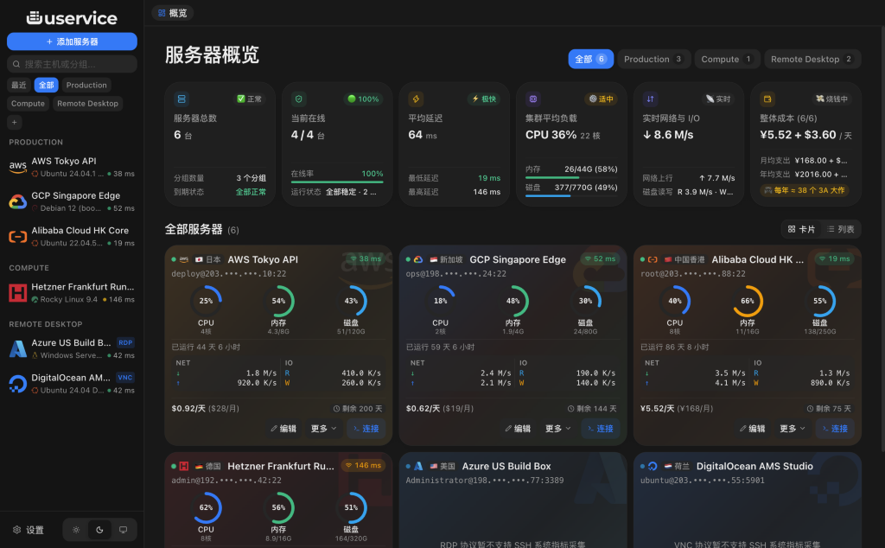
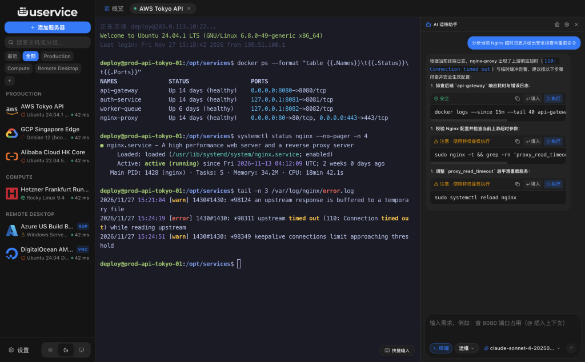
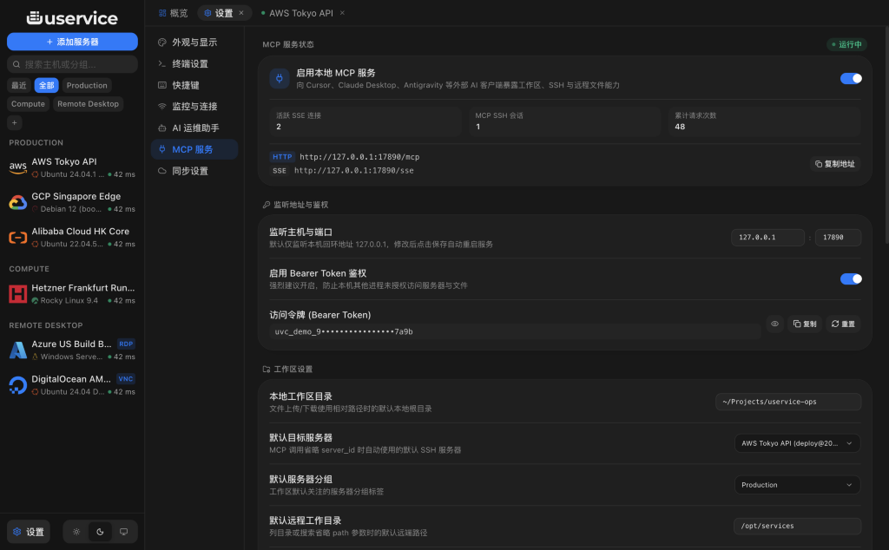
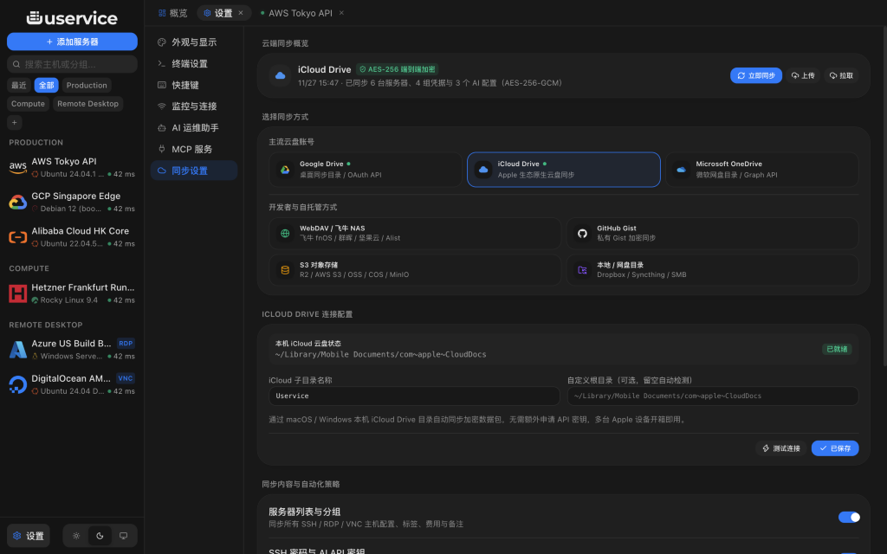

<div align="center">
  <picture>
    <source media="(prefers-color-scheme: dark)" srcset="assets/logo/uservice-logo-dark.svg">
    <source media="(prefers-color-scheme: light)" srcset="assets/logo/uservice-logo-light.svg">
    
  </picture>

  <p><strong>基于 Tauri 2 与 Rust 构建的跨平台服务器管理客户端</strong></p>

  <p>
    <a href="README.md">简体中文</a> ·
    <a href="README.en.md">English</a>
  </p>

  <p>
    <a href="https://github.com/anxu1860/Uservice/actions/workflows/ci.yml"></a>
    <a href="LICENSE"></a>
    
    
    
  </p>
</div>

---

**Uservice** 是一款基于 Tauri 2、Rust 与 React 构建的跨平台开源服务器管理客户端（支持 macOS / Windows / Linux）。它统一管理 SSH、VNC 与 RDP 远程连接，原生集成终端 AI 助手与本地 MCP Server，让日常运维和外部 AI Agent 都能安全高效地操作服务器；同时内置本地加密凭据库，并支持多设备端到端加密配置同步。

## 界面预览

### 服务器概览
统一管理多云主机、分组标签、云厂商与区域识别、费用与到期提醒。



### SSH 终端与内置 AI 运维助手
基于纯 Rust (`russh`) 与 `xterm.js`（WebGL 加速、日志高亮、多主题与跳板机支持），侧边栏内置上下文感知的 AI 运维助手，支持命令风险评估与一键填入/执行。



### 内置本地 MCP Server
提供本机回环监听的 Streamable HTTP / SSE MCP 服务，支持 Bearer Token 鉴权、细粒度能力开关与调用日志审计，让 Cursor、Claude Desktop、Antigravity 等外部 AI 客户端直接安全地管理工作区、执行 SSH 命令与传输文件。



### 多云端到端加密同步
支持 iCloud Drive、Google Drive、OneDrive、WebDAV / NAS、GitHub Gist、S3 兼容对象存储及本地网盘目录，所有配置与凭据均在本地通过 AES-256-GCM 加密后再同步。



## 核心特性

- **多协议远程连接**：统一支持 **SSH**（纯 Rust `russh`、多级跳板机、`~/.ssh/config` 导入、多认证优先级）、**RDP**（IronRDP WASM + 本地 RDCleanPath 安全桥接与证书指纹校验）及 **VNC**（noVNC）。
- **终端 AI 运维助手**：兼容 OpenAI API、Anthropic Claude、Google Gemini 及本地 Ollama；支持终端上下文感知、敏感凭据自动脱敏与命令安全风险分级提示。
- **内置本地 MCP Server**：默认仅绑定 `127.0.0.1`，提供 Bearer Token 鉴权、DNS Rebinding 防护与 25 项工具（工作区管理、SSH 命令与交互会话、远程文件读写搜索、带 SHA-256 校验的文件传输）。
- **本地加密凭据库与主机制约**：基于 SQLite + AES-256-GCM + HKDF 加密存储密码与私钥口令（释放时内存零化），配合 TOFU 主机指纹校验抵御中间人攻击。
- **多云端到端加密同步**：基于 PBKDF2-HMAC-SHA256 与 AES-256-GCM 的客户端加密信封，跨设备同步服务器列表、凭据、AI 配置与应用设置。
- **原生桌面体验**：支持 macOS 原生毛玻璃侧栏 / Windows Mica 材质、浅色/深色主题自适应与自定义快捷键。

## 架构概览

```text
├── app/                   # React 19 + TypeScript + Tailwind v4 前端与 Tauri 2 壳层
│   ├── src/               # 界面组件、终端主题/高亮、快捷键与前端封装
│   └── src-tauri/         # Tauri 命令、本地加密凭据库、MCP Server、多云同步引擎
├── crates/
│   ├── core/              # 服务器/凭据数据模型、持久化存储与 ~/.ssh/config 解析
│   ├── ssh/               # 纯 Rust SSH 客户端（russh）与 TOFU known_hosts 校验
│   ├── bridge/            # VNC / RDP 本地 WebSocket & RDCleanPath 安全桥接
│   ├── ai/                # 多协议 AI 流式客户端（OpenAI / Anthropic / Gemini）与脱敏
│   ├── monitor/           # 主机状态解析模块
│   └── sync/              # 加密同步后端抽象
└── assets/                # 品牌 Logo 与图标资源
```

## 快速开始

### 环境要求

- **Rust** `>= 1.88`（包含 `rustfmt` 与 `clippy`）
- **Node.js** `>= 20` 与 **pnpm** `10.x`
- 平台原生依赖：
  - **macOS**：Xcode Command Line Tools
  - **Windows**：WebView2 与 Visual Studio C++ Build Tools
  - **Linux**：`libwebkit2gtk-4.1-dev`、`libayatana-appindicator3-dev`、`librsvg2-dev`、`libssl-dev`、`libxdo-dev`、`patchelf`

### 本地开发

```bash
git clone https://github.com/anxu1860/Uservice.git
cd Uservice/app
pnpm install
pnpm tauri dev
```

### 测试与代码检查

```bash
cargo fmt --all -- --check
cargo clippy --workspace --all-targets -- -D warnings
cargo test --workspace
cd app && pnpm build
```

## 参与贡献与安全反馈

- 提交 Issue 或 Pull Request 前请先阅读 [CONTRIBUTING.md](CONTRIBUTING.md)，并使用仓库提供的结构化 Issue 表单。
- 如发现安全漏洞，请勿公开提交 Issue，请参考 [SECURITY.md](SECURITY.md) 通过私密渠道上报。

## License

本项目采用 [Apache-2.0](LICENSE) 开源协议。
